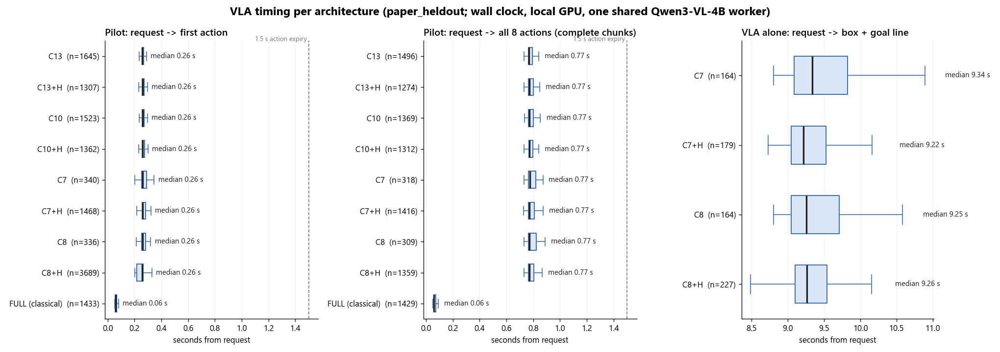

# DRAFT v0 (2026-10-22) - working title

**Diagrams Don't Fly: Handles, Not Architecture Families, Decide Whether Small Foundation Models
Can Plan for a Drone**

Status: v0, structure and argument. Numbers marked [TBD] wait for the full D-166 matrix (three
seeds) and the handle ablation (not built yet). Findings and their evidence are tracked in
`docs/RESEARCH.md`. Nothing here is a claim until it appears there with evidence.

---

## Abstract (draft)

Foundation-model autonomy for drones is usually described by its architecture family. The
families are:
- an LLM that calls skills;
- a VLM that points to waypoints;
- a vision-language-action (VLA) model that flies directly;
- hierarchies that combine them.

We ask whether the family decides success. We build twelve such architectures as configurations
of one runtime, with the same small on-board model (Qwen3-VL-4B, plus a trained 4B VLA adapter),
the same real-time loop, the same path planner and safety shield, and the same twelve capability
tasks. Built only from their diagram's modules, every model-driven architecture solves simple
see-and-go missions and fails every task that needs planning: a conditional branch, an ordered
visit, recovery from a closed passage, following a moving target (0/12 planning passes for
every model-driven architecture over 432 flights).

The same model improves from 0/9 to 5/9 when only the connective logic changes. That logic
includes typed task contracts, a single owner of mission sequencing, evidence-based completion,
and the perception-to-state hand-off. We call this logic the system's *handles*. Adding three
handles to the most complete vanilla stack, with no other change, raises it from 21/36 to
30/36 and from 0/12 to 6/12 planning passes. Removing the typed contract or the executive alone
returns it to 21/36. The same handles also lift the two other planner architectures
(C13 22 -> 27, C10 16 -> 21), and handles that fit the other connections lift every
architecture without a planner (C2 12 -> 19 ... VLA alone 0 -> 6), though only planner stacks
gain planning tasks. Two time-critical tasks stay unsolved by every architecture, the oracle
included: they are bound by model latency, not by the logic between the modules.

We argue that the handles, not the architecture family, determine whether a small foundation
model can plan for a drone. Architecture comparisons should report them as first-class factors.

## 1 Introduction (draft)

- Drone autonomy papers present systems as boxes: planner, perception, executor, monitor.
  Comparisons between families are made across different models, simulators, sensors and
  prompts, so a difference in success cannot be attributed to the family.
- We remove those confounds. One model, one runtime and one task suite run all families as
  configurations; only the architecture switches change.
- The first result is negative and, we think, important. The diagram alone does not plan: every
  vanilla configuration fails the planning tasks.
- The working systems we and others built (AerialClaw, our drone_control stack, and our own live
  stack after repair) all work because of logic outside the diagram. This matches the scaffold
  literature (LLM-Modulo, AgentSpec, Inner Monologue, ProgPrompt, SayCan, TypeFly).
- Contributions:
  1. a controlled testbed where architecture families are configurations of one runtime and one
     model;
  2. a twelve-architecture by twelve-task evaluation with paired seeds, an oracle ceiling and a
     cost vector;
  3. a taxonomy of handles (H1-H8) with controlled add-one / remove-one ablations [TBD];
  4. evidence that a trained VLA is a good pilot inside a hierarchy and a poor planner alone.

## 2 Related work (outline)

- **Architecture families for LLM/VLM drones.** TypeFly, AerialClaw, See-Point-Fly, OnFly,
  PMR / Selective Agentic Recovery, CognitiveDrone (-R1), FLIGHT, AeroVLA. Source:
  `docs/research/*`, the 94-paper UAV survey.
- **Scaffolds and handles.** LLM-Modulo, AgentSpec, Embodied Agent Interface, Inner Monologue,
  ProgPrompt, Code as Policies, SayCan, CoPAL, the DroneServer MCP harness. Source:
  `docs/research/HANDLES_20261022.md`.
- **Benchmarks.** AerialVLN, UAV-Flow, CognitiveDrone. The gap: no architecture comparison under
  identical constraints (survey Table 8).

## 3 Testbed (draft, from D-159 - D-166)

- **One model.** Qwen3-VL-4B (NF4) serves every language / vision role. The D207 LoRA adapter
  (trained on UAV-Flow, 70.3 % on its test set) serves VLA pilot roles. One GPU owner; calls
  are serialized.
- **One runtime.** A wall-clock 20 Hz control loop. Model latency is paid, not simulated. Actions
  expire. All roles share the asynchronous scheduler.
- **Shared execution.**
  - SUPER local path planning on the range fan, with the same parameters as the oracle ceiling;
  - a velocity controller;
  - a collision shield, except C7 (no shield by definition).
- **Tasks.** Twelve capability tasks in a rendered 3-D grid simulator with an independent
  evaluator that no model sees:
  - basic: coordinate, visible target, approach-and-hover;
  - perception: search, the overturned vehicle among two;
  - planning: conditional gate, ordered visit, closing passage, follow;
  - obstacles: post, slalom, low wall.
- **Protocol.** Development seeds 1060-1062 for every reported matrix. Held-out seeds run once.
  No per-task tuning, no retries.

## 4 Architectures as configurations (draft table)

| ID | Who decides the goal | Pilot | Verifier | Monitor | Recovery | Memory |
|---|---|---|---|---|---|---|
| C0 | evaluator goal (privileged ceiling) | classical | yes | - | - | - |
| C1 | text-only LLM picks one skill per turn | classical | yes | - | - | skill history |
| C2 | VLM points in the image | classical | - | - | - | - |
| C3 | as C2 | classical | yes | - | - | - |
| C4 | as C2 | classical | yes | periodic | - | - |
| C5 | as C2 | classical | yes | periodic | - | yes |
| C6 | as C2 | classical | yes | - | event | - |
| FULL | LLM plans steps, VLM grounds them | classical | yes | arrival + periodic | event | yes |
| C7 | the VLA writes its own goal line | VLA | - | - | - | goal memory |
| C8 | as C7 | VLA + shield | yes | - | - | goal memory |
| C10 | as FULL, planner on a period | VLA | yes | yes | periodic | yes |
| C13 | as FULL, planner on events | VLA | yes | yes | event | yes |

## 5 Results (to fill)

- **5.1 Vanilla matrix** (432 flights, seeds 1060-1062, zero collisions; D-169). Passes / 36:
  C0 28; C13 22; FULL 21; C5 and C6 18; C10 16; C3 and C4 15; C2 12; C1 9; C7 and C8 0.
  Planning tasks: 0/12 for every model-driven architecture (C0 4/12). Tables:
  `reports/paper_matrix_d165/tables.md`.
- **5.2 The same model, different handles.** The history D-143 -> D-145 (0/4 -> 4/4) and
  D-150 -> D-158 (0/9 -> 5/9).
- **5.3 Handle ablation** (FULL base, 3 seeds; D-171 v2, D-173 v3). v3: FULL 21/36; + H1 24/36;
  + H2 21/36; + H1 and H2 27/36, with planning 0/12 -> 3/12 (ordered visit 3/3) and every
  non-planning task passed. The executive alone does nothing; the pair is better than either.
  Remaining failures: wall openings cannot be grounded by the 4B VLM, and tracking.
- **5.4 Stacking a perception handle** (D-174, D-175). + H5 measured openings: 28/36 when the
  measured facts are only given to the VLM, which ignores them; 30/36 when sensor-answerable
  questions are routed to the range sensor. The if-then gate goes to 3/3.
- **5.5 Remove-one ablation of the final stack** (D-180, 3 seeds x 12 tasks).

  | Arm | Passes / 36 | Planning / 12 |
  |---|---|---|
  | H1 + H2 + H5 | 30 | 6 |
  | minus H5 | 27 | 3 |
  | minus H2 | 21 | 0 |
  | minus H1 | 21 | 0 |
  | no handles (FULL) | 21 | 0 |

  H1 and H2 are each necessary: removing either returns the stack to the no-handle level. H5
  only helps on top of both.
- **5.6 Negatives and the latency floor** (D-176 to D-179). Looking while moving (H7) and two
  wall-detour designs did not help. follow_target and closing_passage fail for every
  architecture, C0 included on follow, because the first move comes after about 5.7 s of model
  time.
- **5.7 VLA alone vs in a hierarchy.** C13 22/36 against C7 / C8 0/36 (D-169).
- **5.8 The same handles on other architectures** (D-181). The handle set fits unchanged on every
  architecture with a planner -> executor connection: FULL 21 -> 30, C13 22 -> 27, C10 16 -> 21.
  C13 + H solves the if-then gate as FULL + H does. On C10 the timed planner overrides the
  executive (two sequencing owners), and with the VLA pilot the ordered visit runs out of time.
  C1-C6 have no such connection, so the handles are not applicable there; no box is added.
- **5.9 Handles for the architectures without a planner** (D-182). H3 (search policy), H4
  (evidence-based completion) and H9 (measured distance) act on connections C2-C8 already have.
  C2 12 -> 19, C3 15 -> 21, C4 15 -> 23, C5 18 -> 23, C6 18 -> 23, C7 0 -> 6, C8 0 -> 6. H3 and
  H4 already existed in FULL's planned path ("hidden handles") but never reached C2-C5.
  Planning tasks stay at 0 without a planner: the handles that solve planning need a plan
  connection to act on.
- **5.10 Timing: where the VLA is fast and where it is slow** (D-183T; held-out seeds 1-8, about
  15,000 VLA requests; `scripts/paper_vla_timing.py`, Figure T1). As a pilot, the VLA streams
  its first action at a median of 0.26 s and a full 8-action chunk at 0.77 s, the same in every
  architecture, with or without handles. That is well inside the 1.5 s action expiry; the
  classical pilot takes 0.06 s. As the sole decision-maker (C7 / C8), writing its own target box
  and goal line takes a median of 9.3 s per line. So actions are fast enough in every
  architecture; the VLA is slow only where it must decide where to go. This fits the latency
  floor in 5.6: the cost is in the deciding calls (planner, grounding, goal line), not in flying.
  Figure T1: `figures/vla_timing.png`.

- **5.11 Held-out confirmation** (D-184H; 22 arms x 12 tasks x held-out seeds 1-10 = 2,640
  flights, frozen code, run once). Passes / 120, without -> with the handles that fit:
  C2 40 -> 66, C3 52 -> 77, C4 50 -> 75, C5 61 -> 76, C6 62 -> 77, C7 0 -> 22, C8 0 -> 21,
  FULL 71 -> 99, C10 52 -> 75, C13 66 -> 83; C0 (privileged) 95, C1 31. Planning tasks / 40:
  FULL 0 -> 20, C13 0 -> 9, C10 0 -> 3, every architecture without a planner 0. FULL + handles
  beats the privileged C0 overall (99 vs 95) and on planning (20 vs 15). One safety
  interaction: C7 + H (no shield) collides on both obstacle tasks (20 flights), because the
  measured distance makes it fly far enough to reach them; C8 + H (shield) has none. All other
  arms have 0 collisions. Tables: `reports/paper_heldout/tables.md`.
- **5.12 Which part limits each architecture** (D-185 to D-187; perfect-part swaps on all
  architectures, development seeds). Pilot: never (C0-VLA 27 vs C0 28 / 36). Perception: only
  the overturned vehicle (+1 to +3 per architecture). Plan: no gap left in the handled planner
  stacks (a perfect plan delivered after the model's 5.5 s planning time scores the same).
  Planning tasks without a planner: 0 even with perfect perception. Timing: follow_target (look
  latency) and closing_passage (the wall closes before any plan exists, then no recovery around
  the corner). Methodological note: a perfect part must be delivered after the model's own
  measured latency; an instant oracle confused "perfect" with "early" twice (grounding on
  follow, plan on closing_passage).
- **5.13 Equal handle budget, then plateau** (D-187). A second fix round per architecture:
  C10 + H 21 -> 25 (H8 progress-aware review), C2 + H 19 -> 24 (H12 lenient output), and no
  change for FULL + H, C13 + H or C1. H11 (plan check) is a measured negative.
- **5.14 Perception options** (D-186, offline, same 54 frames). Box centre on the pillar:
  YOLO-World 33/39, OWLv2 36/39, the VLM 33/39; overturned car right: 0/9, 2/9, 6/9; time per
  look 37 ms, 414 ms, 1.5-3 s. Detectors are not more accurate here; YOLO-World is about 50x
  faster. The fitting use is a hybrid perception box (planned as a variant, step 4).
- **5.15 Hidden handles** (D-182, D-187). Behaviour credited to boxes is sometimes logic inside
  them: FULL's planned path carried H3 / H4; C3's verifier carried the coordinate-format repair
  that C2 lacks (C2 known_goal 0/10 held-out; 3/3 with H12). Vanilla rankings partly measure
  hidden handles.
- **Figures: task maps** (`scripts/paper_task_maps.py`). One page per task, one top-down panel
  per architecture, path coloured by time:
  - Figure M0: architecture legend (`figures/maps_legend.png`).
  - Figure M1: if-then gate (`figures/map_s1060_conditional_gate.png`).
  - Figure M2: ordered visit (`figures/map_s1060_ordered_visit.png`).
  - Figure M3: closing passage (`figures/map_s1060_closing_passage.png`).
  - Figure M4: follow target (`figures/map_s1060_follow_target.png`).
  - Figure M5: obstacle slalom (`figures/map_s1060_obstacle_slalom.png`).
  - Figure M6: approach and hover (`figures/map_s1060_approach_hover.png`).
  - Figure M7: turn and search (`figures/map_s1060_turn_search.png`).

## 6 Discussion (outline)

- **Why vanilla fails planning.** Per-module failure attribution, in the Embodied Agent Interface
  style:
  - goal interpretation (the branch flattened in conditional_gate);
  - state tracking (the second target lost in ordered_visit);
  - recovery (no route when the passage closes);
  - missing behaviour (no tracking skill).
- The taxonomy H1-H8 and what each fixes.
- Implications for comparing published systems: report the handles.

## 7 Limitations (outline)

- A synthetic rendered simulator, not AirSim or real flight.
- One model family, at 4B.
- Development seeds 1060-1062 for all design; one held-out run (seeds 1-10) at the end.
- Development outcomes were near deterministic across the three development seeds (PPP or FFF).
  The ten held-out seeds vary more, but each task still uses one scene family per seed.
- The handles are partly designed by us. We mitigate this by using only public mission text
  and sensed state, never evaluator truth.
