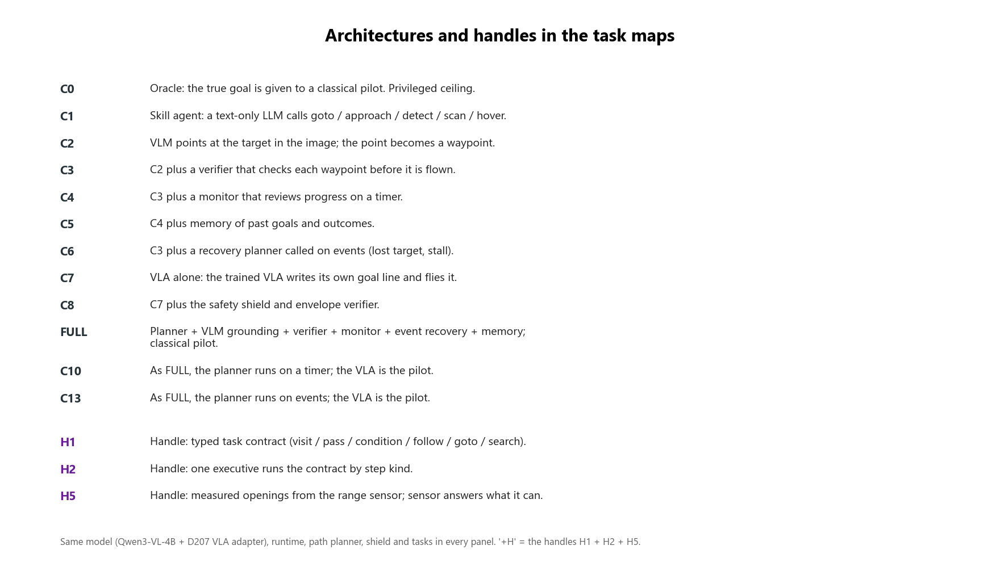
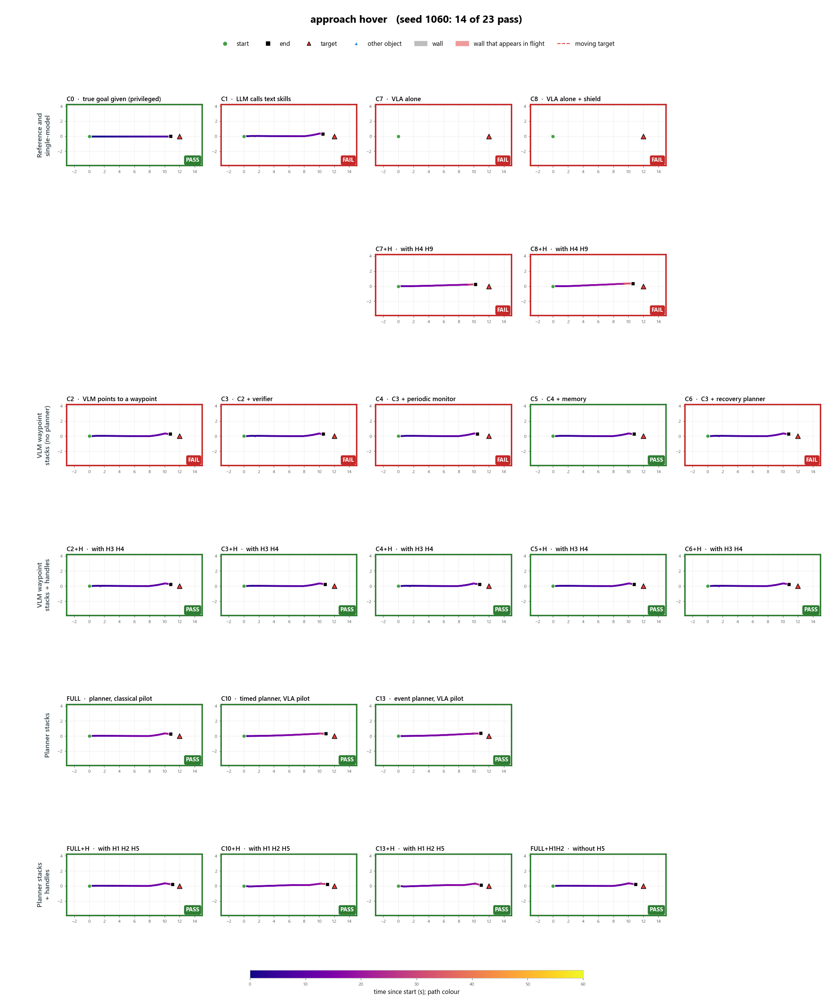
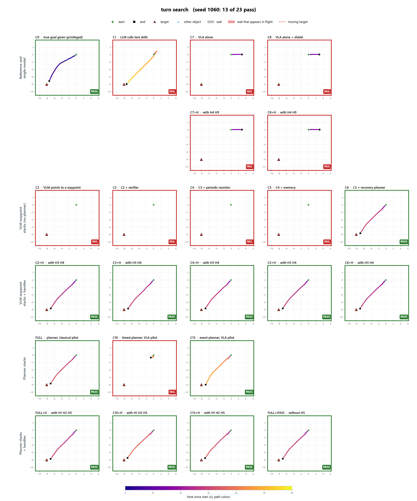
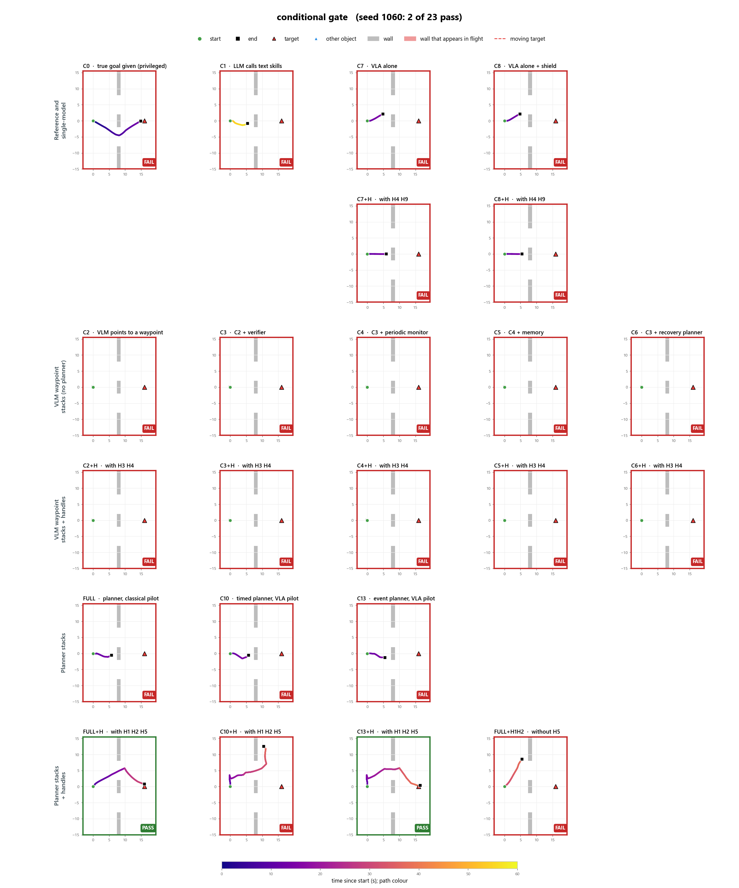
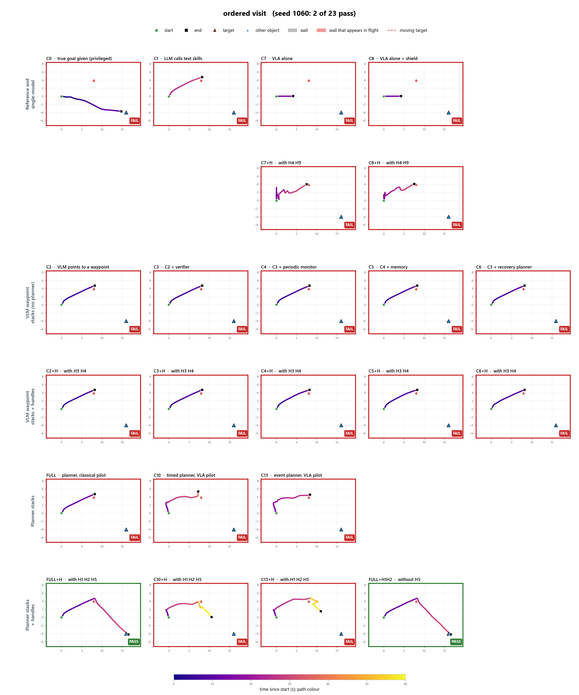
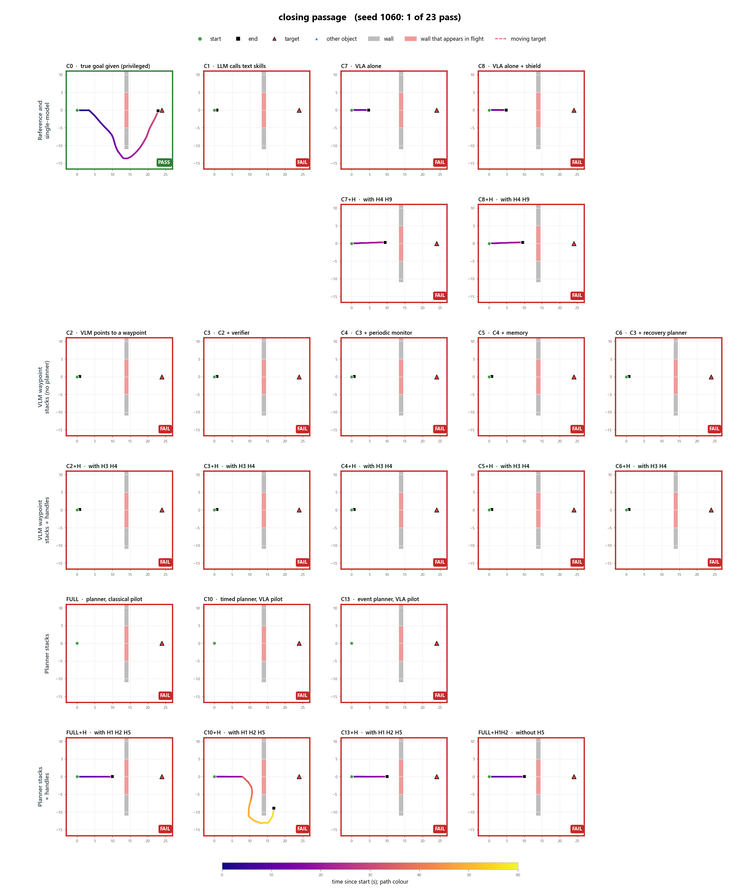
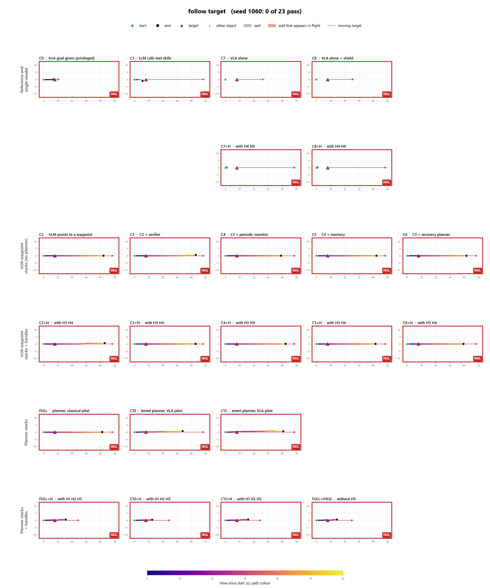
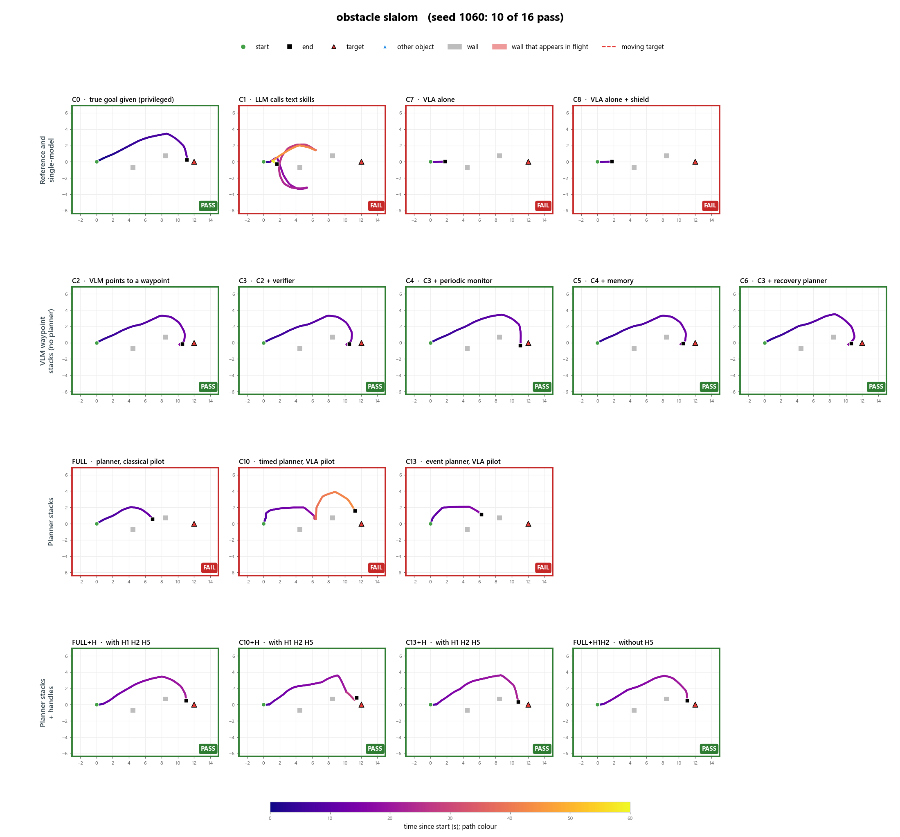

# Handles: results (D-168 to D-182, 2026-10-22)

Companion to the research note (in the PDF it follows this section). All runs use the same model (Qwen3-VL-4B + D207 adapter),
the same real-time runtime, the same 12 tasks and development seeds 1060-1062. Each variant
was flown 36 times. These are development results; the held-out run comes at the end.

## The handles built so far

| Handle | What it is | What it changes |
|---|---|---|
| H1 typed task contract | The planner writes a small typed program (visit, pass, condition, follow, goto, search) instead of plain text steps | What the planner hands over |
| H2 kind-aware executive | One owner runs that program: asks the camera at a branch, flies through openings, follows for the stated time, advances only on evidence | Who runs the plan, and how |
| H5 measured openings | Gaps in walls measured by the drone's range sensor, given to checks and fly-through steps; questions the sensor can answer are routed to it | How perception reaches the plan |
| H7 look while following (negative) | A follow step looks again while moving instead of stopping each time | Timing of perception during tracking |

None of these adds a box to the architecture diagram. They change the logic between the boxes.

## Step 1: H1 and H2, alone and together (FULL stack as base)

| Variant | Passes / 36 | Planning tasks / 12 |
|---|---|---|
| FULL (no handles) | 21 | 0 |
| + H1 only | 24 | 0 |
| + H2 only | 21 | 0 |
| + H1 and H2 | 27 | 3 (ordered visit 3/3) |

Neither handle helps planning alone. A typed plan that nobody executes is inert, and an
executive with nothing typed to execute does nothing. Together they solve the first planning
task. This matches the scaffold literature: interaction between components matters more than
any single module.

How the version-1 handles failed is evidence too. The planner wrote a correct if-then program,
and a strict validator rejected it for one extra field. Fixing the connecting logic, not the
model, is what moved the score:

| Version | H1 + H2 |
|---|---|
| v1 | 18/36 |
| v2 | 26/36 |
| v3 | 27/36 |

## Step 2: adding H5 (measured openings) on top of H1 + H2

| Variant | Passes / 36 | Planning / 12 | What changed |
|---|---|---|---|
| H1 + H2 | 27 | 3 | - |
| + H5 (facts given to the model) | 28 | 4 | the gate is reached every time, but the right branch only 1/3 |
| + H5 with check routing | 30 | 6 (gate 3/3, ordered visit 3/3) | sensor-answerable questions answered by the sensor |

The small model ignored the correct measured facts in its answer: it said "no left opening"
when the sensor measured one. Routing the question to the sensor fixed it on every seed. This is
another connecting-logic decision, not a better model.

## Step 3: what did not work (rounds 3 to 5)

| Try | Aimed at | Result |
|---|---|---|
| H7 look while following | follow target | The drone flew half as far: looks took GPU time from the pilot |
| Wall-end detour (fly past the measured wall end) | closing passage | Flew beside the wall end, not past it; cost the gate one seed |
| Detour behind the wall + progress along the planned path | closing passage | Correct aim, but the drone stops at the wall corner; cost the gate one seed |

All three are kept behind switches, off in the final stack, as measured negatives.

Why these two tasks stay open: they are time-critical. On follow, the first move comes after
about 5.7 s of model time (planning 2.6 s plus the first look 3.1 s), and by then the marker is
already out of reach; even the privileged C0 fails it. On closing passage, the wall closes at
3 s, while the planner is still writing the plan. Changing the logic between the boxes cannot
remove model latency.

## Step 4: remove-one ablation of the final stack

| Arm | Passes / 36 | Planning / 12 | Tasks lost |
|---|---|---|---|
| H1 + H2 + H5 (final) | 30 | 6 | - |
| minus H5 | 27 | 3 | if-then gate |
| minus H2 | 21 | 0 | gate, ordered visit, approach and hover |
| minus H1 | 21 | 0 | gate, ordered visit, obstacle slalom |
| no handles (FULL) | 21 | 0 | - |

H1 and H2 are each necessary: take either one out and the stack falls back to the no-handle
score. H5 only helps on top of both.

Caveat: every task gave the same result on all three seeds, so each arm behaves more like 12
outcomes than 36 trials. The differences are whole tasks that flip, not noise, but the held-out
seeds must confirm them.

## Step 5: the same handles on the other planner architectures

The handles act on the planner -> executor connection, so they fit unchanged on the three
architectures that have one. Nothing is added to any architecture. C1-C6 have no such
connection, so these handles do not apply there.

| Architecture | Without handles | With H1 + H2 + H5 | Gain |
|---|---|---|---|
| FULL (classical pilot) | 21 | 30 | +9 |
| C13 (event planner, VLA pilot) | 22 | 27 | +5 |
| C10 (timed planner, VLA pilot) | 16 | 21 | +5 |

- C13 + handles solves the if-then gate 3/3, like FULL + handles.
- C10 + handles picks the right opening, then its timed planner review overrides the executive
  and sends the drone off course. Two owners of the plan conflict, which is the reason H2 exists.
- Ordered visit fails with the VLA pilot. The order is right, but the pilot is slow, so the
  first pillar is reached at 48 s and time runs out before the second.

## Step 6: handles for the architectures without a planner (C2-C8)

H1, H2 and H5 need a planner. C2-C8 have other connections, and three handles act on those,
again without adding any box:

| Handle | Connection | Fits |
|---|---|---|
| H3 search policy | target not visible -> bounded camera search, when the mission says find | C2-C6 |
| H4 evidence-based completion | the stop decision: stated standoff / hold, object passed below | C2-C8 |
| H9 measured distance | the VLA picks the target box, the depth sensor gives the distance | C7, C8 |

The code audit found that H3 and H4 already existed, but only on the planned path, so FULL had
them and C2-C5 never did. These were hidden handles inside the "full" architecture.

| Architecture | C2 | C3 | C4 | C5 | C6 | C7 | C8 |
|---|---|---|---|---|---|---|---|
| without handles | 12 | 15 | 15 | 18 | 18 | 0 | 0 |
| with handles | 19 | 21 | 23 | 23 | 23 | 6 | 6 |

- Approach and hover: 0/3 -> 3/3 on C2, C3, C4 and C6 (H4 reads "hover 1 m, hold 2 s").
- Turn and search: 0/3 -> 3/3 on C2-C5 (H3).
- C7 / C8, the VLA alone: 0 -> 6. The VLA boxes the target correctly; the sensor fixes its
  distance. They still fail the obstacle tasks, because they fly without the path planner.
- Planning tasks stay 0/12 on all of them. With no planner, nothing holds a branch or an order.

## Where this stands

| Configuration | Passes / 36 | Planning / 12 |
|---|---|---|
| Privileged C0 (true goals) | 28 | 4 |
| Best vanilla architecture (C13) | 22 | 0 |
| FULL | 21 | 0 |
| FULL + H1 + H2 + H5 | 30 | 6 |
| C13 + H1 + H2 + H5 | 27 | 3 |

Every architecture improves with the handles that fit it (C2 12 -> 19 ... C7 0 -> 6). Only the
planner stacks gain planning tasks.

Same model, same tasks, same seeds. The difference is only the handles. The handled stack even
beats the privileged C0 on the planning tasks, because C0 has the true goal but no plan logic.

## Task maps: what happens when

Each page is one task (seed 1060). Every panel is one architecture, seen from above. The line is
the drone's path, coloured by time (dark = start, yellow = 60 s). Grey blocks are walls, red
blocks are walls that appear during the flight, and triangles are objects (black edge = the
target). Rows: each group of architectures, with its handled version (+H = the handles that fit that
architecture) in the row directly below. All 12 tasks for all three seeds are in reports/paper_maps/.

**Legend.** What each architecture code means.

**Approach and hover.** Every VLM waypoint stack gets to the pillar, but C2, C3, C4 and C6 stop at
the wrong distance and never hold. With H4 they read "about 1 m, hold for 2 s" from the mission
and pass, as FULL does through its planner.

**Turn and search.** The pillar starts behind the drone. C2-C5 never turn, because nothing
authorizes a search without a planner. With H3 they turn, find it and fly to it.

**If-then gate.** Only FULL + H and C13 + H pass: the range sensor answers which opening is clear, and the drone flies through it and on to the pillar. Every vanilla stack stops before the wall. C10 + H takes the correct opening, then its timed planner sends it north.

**Ordered visit.** Every vanilla stack flies to the red pillar and stops: the two-step mission becomes one visit. With the typed plan and executive (FULL + H, FULL + H1H2) the drone visits red, then flies on to blue. C10 + H and C13 + H keep the order, but the slow VLA pilot is still near red when time runs out (yellow).

**Closing passage.** Only C0, which is given the true goal, flies around the wall that closes at 3 s. The handled stacks fly up to the wall and stop; C10 + H goes around the end too late. This task stays open: the wall closes while the planner is still thinking.

**Follow target.** No architecture passes. The vanilla stacks chase the marker down the track but stay too far behind it. The handled stacks keep the stated 4-6 m band only after a late start, and end at 20 s as the mission says. The first move comes about 5.7 s in, which is too late.

**Obstacle slalom.** The vanilla planner stacks (FULL, C10, C13) stop between the posts; with the handles, the same stacks reach the target like the simpler C2-C6 stacks.

