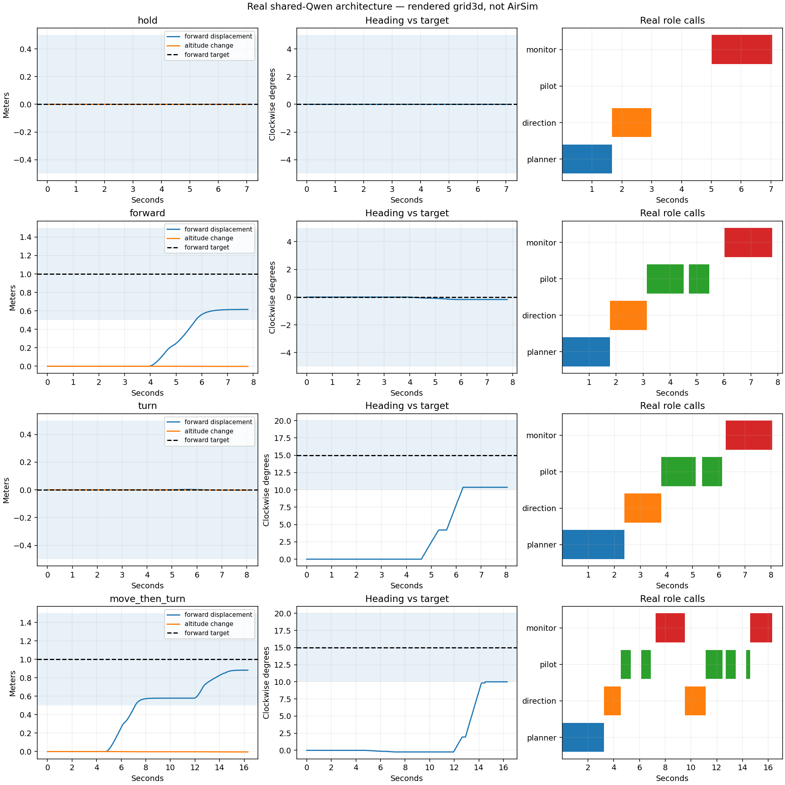

# D145: ordered missions and completion repair

Final real-model local rerun: **4/4 pass**, compared with D144 0/4. This is a coordination repair with frozen weights, not training or evidence of more precise pilot control. The complete final configuration exactly equals D144: same four instructions, seeds1071-1074, 60-second per-task horizons, 0.5m/5degree/0.2m/s completion, 1.5-second action freshness, and independent hold/order/timing checks.

| Task | Pass | Position error m | Heading error deg | Flight wall-paced seconds | Executed actions |
|---|---|---|---|---|---|
| hold | True | 0.0000 | 0.0000 | 7.09 | 0 |
| forward | True | 0.3843 | 0.1739 | 7.84 | 4 |
| turn | True | 0.0022 | 4.6258 | 8.10 | 4 |
| move_then_turn | True | 0.1172 | 4.9961 | 16.35 | 11 |

All19 actions fresh; zero collisions, out-of-bounds events, malformed responses or contract failures in final run. Maximum control gap52.67ms passes150ms. Hold has zero movement and no pilot actions. Compound has two committed targets, an explicit intermediate advancement, and forward arrival before significant turning. Both original startup action-equality checks pass. GPU unloaded to12MiB/0% after completion.

## What changed

Planner produces an ordered list of per-step changes. The scheduler accumulates numeric changes into episode-start targets and retains the original mission and full plan across replans. For move then turn, changes [1,0,0,0] then [0,0,0,15] become targets [1,0,0,0] then [1,0,0,15]. This is deterministic coordinate bookkeeping of model outputs, not evaluator expected-target injection. The direction model sees only the active objective and target; proposals that change it are rejected. Final-step status is owned by the scheduler.

Monitor inputs explicitly distinguish measured errors from positions and use short responses. Hold pauses without destroying the plan. Stop outside any fixed tolerance is rejected. The scheduler additionally computes numeric completion for scene-clear continue responses; hold/replan remain vetoes. Visual tasks do not get this numeric override.

**The VLM's arithmetic is still unreliable.** In the compound first stage it said `Position error 0.478m exceeds 0.5m tolerance.` The scheduler accepted measured arrival/stationarity and logged one numeric_completion_override. The last step received a monitor stop. Do not describe this as repaired model arithmetic or VLM-only success.

## Precision and remaining limitations

Simple forward actually moved about0.616m, and the15degree turn reached about10.374degrees: both meet the original broad tolerance, not exact targets. Compound ends about0.883m forward and10.004degrees right. Its forward position continued from about0.579m to0.883m during the turning stage; the frozen audit requires ordered arrival and final tolerances, not zero translation during that stage. Strict no-translation turning remains unproven for the compound task.

Initial natural-language interpretation is still model-dependent; retaining a plan cannot prove its semantic correctness for unseen missions. These four final plans were inspected and match intended step structure. No obstacle, object-identity, AirSim, or general cognitive-task qualification. Numeric-after-visual sequences require explicit localization and fail closed until supported. This used the existing experimental D142 graph pilot; no AWS, training, weight changes or tolerance/freshness relaxation.

First produced action latency includes new-shape capture: forward/turn two-call medians~0.499/0.493s because cold calls were~0.80/0.78s. Compound five-call median~0.200s,max~0.784s. Do not call this a hard200ms full-system loop. Planner/direction/monitor remain seconds-long event-driven calls.

## Failed intermediate attempts retained

- real_v1:2/4 measured task passes, but hold empty plan, turn invented extra step, compound rejected premature terminal flags. No clean architecture pass.
- real_v2:3/4; hold and simple motion fixed, compound monitor confused remaining error with current position; two truncated JSON replies.
- real_v3:3/4; explicit scalar errors/short replies still produced false arithmetic and blocked compound.
- real_v4:3/4; deterministic numeric completion advanced compound, but direction copied the old target and was rejected three times.
- real_v5:4/4; active-step-only direction context fixes that failure. One transparent numeric override remains.

Each run retains configuration, source hashes, raw event archive with hashes, image inputs, prompt templates, all submitted requests and encoded token input archive. No failed attempt was overwritten. These are development iterations on the same four tasks, not independent generalization trials.

## Evidence and validation

37 focused tests pass: scheduler/control, simulator wiring, independent component audit, mission preservation, step accumulation, numeric completion boundaries, hold veto, and role context isolation. Changed Python files pass check_code and Ruff. Existing independently implemented component auditor was unchanged.

- [Completion rules](MONITOR_RULES.md)
- [All role templates and actual requests/responses](real_v5/PROMPTS.md)
- [Actual decoded token inputs including pilot chat format](real_v5/ENCODED_PROMPTS.md)
- [Exact token IDs archive](real_v5/encoded_prompts.zip)
- [Independent results](real_v5/component_audit.json)
- [Config/source checks](real_v5/closeout_verification.json)
- [Numeric disagreement](real_v5/numeric_overrides.json)

