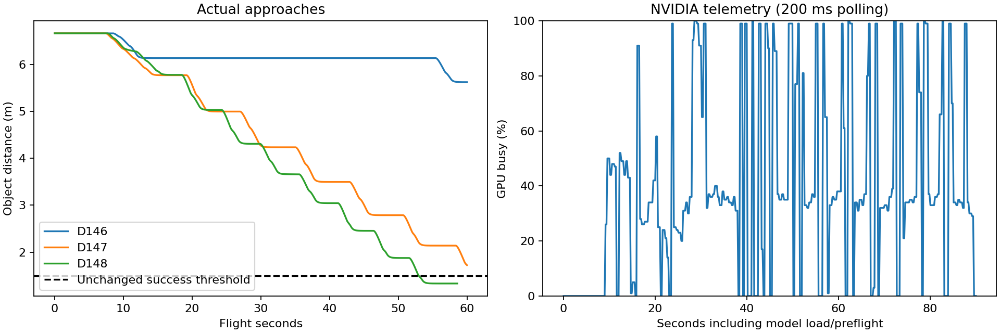
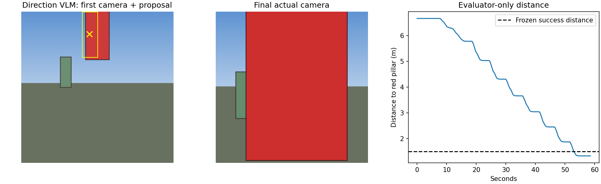

# D148: event-driven planner memory and visual mission completion

The same local pillar task **passes** in one bounded repeat: target visible,
stopped at independent object distance **1.332 m**, speed effectively zero,
47 fresh executed actions, no collisions/out-of-bounds/contract failures.
Flight elapsed 58.564 seconds against the unchanged 60-second horizon and
1.5 m success distance. This is one development fixture with little time margin,
not a general visual-navigation or robustness result. No AWS, training or weights changed.

## What changed and why it helped

The D147 monitor saw local waypoint arrival and repeatedly claimed mission
completion. Code rejected six false stops, but those unnecessary monitor calls
and repeated verification pauses consumed the horizon. D148 separates two events:

1. **Local waypoint reached:** keep the same mission/subgoal; get fresh grounding
   directly. This is not a planner wakeup or a semantic completion decision.
2. **Fresh object proximity observed:** hold position and ask the visual monitor
   whether the requested object is visible and the actual objective is achieved.

The visual monitor no longer receives ambiguous numeric task-arrival fields.
It sees waypoint_reached separately from object_evidence_fresh, object_range_m,
object_near, target identity, stationary, and the required range. The measured
sensor range, source pose and bounded freshness are still independently checked
before accepting stop. No numeric-completion override was used in this flight.

The new planner is an event-driven, bounded recovery agent. It retains the
original instruction, immutable ordered subgoals, completed-step history, active
cursor and last16 observation/event records. Normal grounding/movement updates
memory without waking the planner. Lost target, stalled progress, or explicit
monitor replan requests wake it while motion is held. It chooses retry_current,
refresh_view, or hold. It cannot erase requirements, swap object identity,
skip stages, invent movement commands, or declare completion. This is constrained
recovery planning, not unrestricted rewriting of the mission or cross-mission memory.

## What each part actually did in the flight

| Part | Real calls/actions | Evidence |
|---|---:|---|
| Planner, base Qwen | 1 call | One approach-and-stop objective preserving the entire original instruction; target `red pillar` |
| Grounding VLM, same base | 9 calls | Nine valid boxes; all nine centres on red pixels in offline audit |
| Scheduler/geometry | 8 waypoint refreshes | Retains original object identity; refreshes on arrival without false completion |
| VLA, same base + trained adapter | 20 calls / 47 executed actions | Fresh camera and waypoint remainder drive motion; expired actions not replayed |
| Monitor VLM, base Qwen | 1 call | At near-object event, returns stop with visible/stationary/near evidence |
| Control/safety | 20Hz loop | Max gap62.69ms; no collisions/OOB; same limits |

The final monitor context reports range **1.363 m** from fresh image-aligned
depth, object_near=true and stationary=true. Its exact answer:

`{"status":"stop","reason":"Red pillar visible, stationary, near target range"}`

The independent evaluator's 3D anchor distance is **1.332 m**. These are different
measurements; neither is substituted for the other. Hidden object positions,
red masks and evaluator success labels never enter runtime model prompts.
Pilot bounding-box conditioning remains null: current image plus persistent
waypoint is used, not a stale box copied across new camera frames.

## Before/after under the same configuration

| Run | Final distance | Completed | Monitor calls | Fresh actions |
|---|---:|---|---:|---:|
| D146 corrected visual contract | 5.621 m | No | 11 | 12 |
| D147 grounding/continuation repair | 1.722 m | No | 6 | 44 |
| D148 event/memory and completion repair | 1.332 m | **Yes** | 1 | 47 |

Configuration SHA256 is unchanged:
`555d86256be0f2e27d0491bc635f4bd054b10b758b3fa38e621bc01734da6e69`.
Same seed1075, camera/scene, task instruction, model weights, 60s horizon,
.5m waypoint tolerance,5degree heading,.2m/s stopping,1.5m task distance.
This comparison changes multiple integration behaviors; it is not an isolated
proof that planner memory caused success. No recovery event occurred naturally
in this uncomplicated flight, so the planner correctly ran only once.

## Recovery and monitor controls

`planner_event_probe.json` records three real frozen-model calls using saved
mission/memory with explicitly injected events, without any flight:

| Injected event | Model decision |
|---|---|
| target_lost | refresh_view |
| stalled_progress | retry_current |
| monitor_replan: unsafe | hold |

All three match the declared choices. Live loss/obstruction recovery is still
unqualified; these are not represented as real-flight recovery successes.

`monitor_controls.json` preserves saved-camera, controlled-context tests:

- Near, fresh range1.363m, stationary: stop (expected stop).
- Waypoint reached but object range6.979m: continue (expected continue).
- Waypoint reached but range unknown/stale: replan (expected continue).

The last is a retained **exact-status mismatch**, not a full3/3 prompt pass.
All three avoid false completion; unknown evidence conservatively wakes the
planner. The code gate also rejects stale/missing/far proximity. No prompt or
criteria were changed after seeing this mismatch, and no extra flight was run.

## GPU: busy time, memory, and two-model feasibility

NVIDIA GeForce RTX4060 Laptop GPU,8188MiB total. Read-only nvidia-smi telemetry
sampled every200ms,443 samples including load/preflight;288 during the flight.

| Window | Mean GPU busy | Peak GPU busy | Peak memory |
|---|---:|---:|---:|
| Full run including setup | 39.2% | 100% | 5074MiB (4.96GiB) |
| Flight | 45.8% | 100% | 4338MiB (4.24GiB) |
| Planner request windows | 45.4% | 99% | 4148MiB |
| Grounding request windows | 38.4% | 99% | 4304MiB |
| Pilot request windows | 58.0% | 100% | 4304MiB |
| Monitor request window | 54.1% | 99% | 4338MiB |

These are sampled device-wide busy-time measurements, not SM occupancy or a
percentage of achievable FLOPS. Role windows include CPU preparation/delivery;
the driver's sampling window can overlap adjacent work. NVIDIA defines this
metric as the fraction of the sample period with kernels running:
[nvidia-smi documentation](https://docs.nvidia.com/deploy/nvidia-smi/index.html).

Multiple models can share GPU memory when their weights, caches and workspaces
fit. Kernel overlap additionally depends on streams, contexts and available
hardware resources; concurrency is not guaranteed to improve latency:
[CUDA concurrency guidance](https://docs.nvidia.com/cuda/archive/12.6.3/pdf/CUDA_C_Best_Practices_Guide.pdf).

Our current architecture has **one resident base**, not four model copies.
Planner/direction/monitor use base mode; pilot enables the adapter. Calls are
serialized by the GPU owner because adapter state and graph/cache buffers are
shared. Control and event scheduling remain asynchronous. We did not run two
independent models simultaneously in this experiment.

Measured headroom suggests a small second detector may fit, but latency needs
a separate coexistence test. Two independent copies of this entire measured
4B runtime would exceed8GiB at observed footprints, especially startup peaks.
Low average busy time alone does not prove spare memory-bandwidth/compute or
guarantee unchanged pilot deadlines. Keep the shared base for these Qwen roles.

Actual first-action latency: produced median205.6ms,max805.2ms; received
median253.6ms,max825.1ms. No guaranteed200ms or concurrent-model speedup claim.

## Validation and retained evidence

66 focused tests pass. Ten Python files pass Ruff and repository size/complexity
rules. Tests include event deduplication, bounded memory, immutable mission and
step preservation, recovery authority, direct waypoint refresh, far/stale/unknown
object evidence, and earlier safety/expiry/numeric sequencing checks.

`real_v1/` holds exact prompts, encoded token inputs, source/config hashes,
startup equality, role traces, all source images, evaluator-only state, raw event
archive/manifest, GPU sample archive/manifest and summaries. Code source for the
GPU sampler is also retained. `planner_event_probe.json` and `monitor_controls.json`
contain every controlled-case prompt/response. GPU unloaded after all probes.

Remaining limits: single rendered development scene, nearly full60s used;
no out-of-view search, lookalike identity validation, occlusion, obstacle recovery,
cross-mission memory, AirSim or general cognitive-task qualification. Geometry
still uses the selected pixel, not an independently verified physical object
surface. Next qualification should exercise actual event-driven recovery and
more than one object/scene, preserving objective and safety gates.
