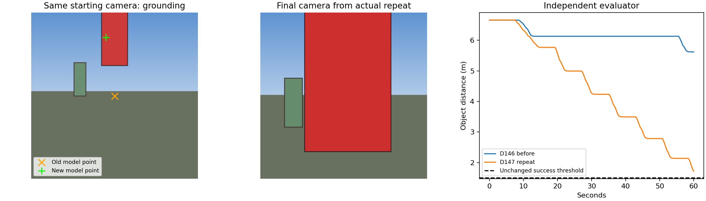

# D147: local grounding and visual continuation repair

The requested repairs improve the same red-pillar approach, but the complete
task still **fails** its unchanged 60-second evaluation. Final distance is
1.722 m versus D146's 5.621 m; success requires <=1.5 m, visible, stationary,
monitor-authorized completion and safe fresh actions. No AWS, training or
model-weight changes. Local GPU unloaded after testing (12 MiB / 0%).

## Saved-image diagnosis first

`grounding_probe.json` preserves four real frozen-model calls on two saved
D146 frames, with input hashes, prompts and raw responses. On both images the
old combined navigation prompt returns its example verbatim: centre point,
1 m travel, target_visible=false, box=null. A localization-only request on
the exact same pixels and model returns visible red-pillar boxes instead.
This establishes prompt sensitivity/template copying in these cases; it does
not prove a universal causal mechanism or general visual competence.

`grounding_controls.json` adds the runtime grounding prompt and terse prompt
on the two saved frames, a blank held-position frame, and the closer D147 v1
frame. Both prompts reject the absent-object control and localize all three
positive views. The closer frame is recognized with approach context but was
missed in v1's separate stop-step context. Target identity is now a noun phrase
kept distinct from movement/completion wording.

## What changed

- Visual direction performs only localization: visible flag and normalized
  box. Validated box centre becomes a bounded 1 m camera-forward waypoint.
  There is no prefilled centre/not-visible answer to copy. Absent objects
  cause a stationary retry, never a blind background approach.
- Visual `continue` at a reached local waypoint revokes old actions and
  requests fresh grounding without changing the mission, step or target.
  Four such refreshes are observed in real_v1; the unit tests exercise this
  path independently. Final real_v3 refreshes via rejected stop verification.
- A dedicated visual planner prompt asks for object identity separately from
  the full objective. Final plan is one step, target `red pillar`, objective
  exactly preserving the original instruction including the stop condition
  and avoidance of other colored objects.
- A monitor stop at a visual waypoint is provisional. Fresh grounding plus
  matching camera depth must establish a finite target-ray range <=1.5 m
  while stationary. Far/missing measurements cannot complete the mission.
- One pending depth snapshot is retained at request submission. The global
  frame store holds only 64 entries; depth could otherwise be evicted while
  the VLM answered. Snapshot, source observation, pose drift and existing
  request TTL checks keep the measurement paired with its image. Limits
  were not increased.

## Same-task results, all attempts retained

All configuration files are byte-identical to D146 real_v2, SHA256
`555d86256be0f2e27d0491bc635f4bd054b10b758b3fa38e621bc01734da6e69`.
Seed1075, red pillar/green distractor scene, 60 seconds, .5 m waypoint arrival,
5 degree heading and .2 m/s stationary tolerances are unchanged.

| Run | Final object distance | Fresh executed actions | Outcome |
|---|---:|---:|---|
| D146 real_v2 | 5.621 m | 12 | Background grounding; waits at waypoint |
| D147 real_v1 | 2.810 m | 38 | Five points on red; four continue refreshes; redundant stop step breaks grounding |
| D147 real_v2 | 1.540 m | 44 | Single goal; depth verification correctly fails closed because source frame was evicted |
| D147 real_v3 | 1.722 m | 44 | Depth snapshot fixed; seven points on red; horizon reached before completion |

These wall-paced runs differ in timing and model inputs across fixes, not just
one isolated variable. v3's slightly worse final distance than v2 is retained;
do not imply monotonic improvement or increase the horizon to manufacture a pass.

## What each component actually did in final real_v3

| Component | Calls | Observed behavior |
|---|---:|---|
| Planner, base Qwen | 1 | One visual goal; original instruction preserved; target `red pillar` |
| Grounding VLM, same base | 7 | Seven visible boxes; seven centres on red pixels in independent offline audit |
| Geometry/scheduler, code | 7 local goals | Turns fresh box centres into bounded waypoints; preserves mission; refreshes after rejected stops |
| VLA, same base with trained adapter | 17 | Produces action chunks; 44 fresh actions executed toward changing waypoint errors |
| Monitor VLM, base Qwen | 6 | All six answers prematurely say stop based on local waypoint arrival |
| Completion verifier, code | 6 | Rejects stop at measured ranges 6.024, 5.279, 4.455, 3.634, 2.858, 2.161 m |

First grounding: normalized box `[400,0,500,300]`; point `[450,150]`,
pixel `[100,33]`, on the red pillar. Old point `[112,112]` was background.
Box IoU varies .411-.939; these are useful points, not precise segmentation.

First VLA request includes the current camera, original objective, measured
state, and remaining `[1.0649,-0.1000,0.5967,-5.3647]` in metres/degrees.
Its first decoded action is approximately `[0.0163,-0.0033,0.1924,-0.00386]`
(FRU metres, yaw radians). The pilot still receives `box=null`: direction
acts through the spatial waypoint, not a stale box reused across new images.
Fresh box tracking/handoff to the action adapter is **not** claimed solved.

Final state: visible=true, stopped=false, speed .1574 m/s, no collision,
no out-of-bounds or contract failures. Max control gap60.19 ms. First-action
backend median206 ms, max804 ms; received median254 ms, max810 ms. No hard
200 ms latency claim. All seven grounding points on red is a fixture-specific
result, not a general benchmark.

## Remaining problem and recommendation

The monitor still confuses local waypoint arrival with completion of the visual
mission. Code now blocks those false positives, but repeated monitor/grounding
pauses consume the horizon. Positive visual completion was tested in unit
fixtures, **not reached in this live repeat**. Next work should give the monitor
explicit distinction between waypoint arrival and fresh object-range evidence,
and reduce redundant checks while preserving safety and task criteria. No new
training is indicated by this integration failure.

Depth is a sensor sample at the VLM-selected pixel, not hidden object position.
It cannot independently prove identity, and a cropped billboard centre/ray is
not necessarily the evaluator's 3D object anchor. The independent object-distance
score remains separate and authoritative for reporting. No red masks, simulator
object coordinates or semantic-hit coordinates enter runtime decisions. Offline
red-pixel checks are for diagnosis only. Search, occlusion, lookalikes, obstacles,
AirSim and general cognitive competence remain unqualified.

## Evidence and validation

55 focused tests pass; code limits and Ruff pass for all eight changed/new
Python files. Includes invalid/absent boxes, identity-preserving continuation,
early/far/nonfinite stop rejection, near acceptance, source-depth eviction,
and existing numeric ordered-step behavior. One regression found while extracting
the stop handler (terminal=False in a manual fixture) was fixed before final run.

Each real_v1..real_v3 folder retains config/source hashes, startup equality,
results, camera images, `PROMPTS.md`, `ENCODED_PROMPTS.md`, exact input-token
archive/manifest and raw event archive/manifest. `real_v3/role_evidence.json`
contains all cognitive responses, first pilot input/output and stop checks.
The final raw events SHA256 is
`ceffaf1b9a844e91f3d8e64e2f0a26747ee408ede23592fdf58dd97682db0e9a`.

Reproduce offline plot with:
`python scripts/diagnostics/compare_qwen_visual.py --after reports/qwen_grounding_fix_20261017/real_v3`
(PYTHONPATH=src). Real flights use the existing run_qwen_visual_object harness;
no additional run is started by this report.
