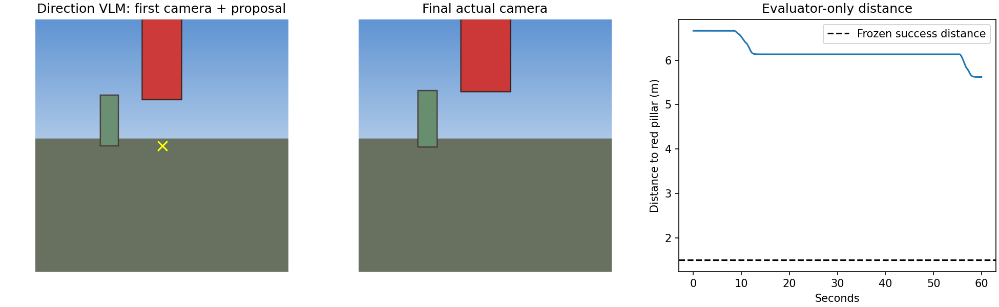

# D146: local visual-object approach diagnostic

**Result: failed.** This is the requested next test of planner/VLM/pilot/monitor interaction after D145 numeric-task success, not a training run. The simulator is rendered grid3d, not AirSim. One visible red pillar, a visible green distractor, seed1075; the red pillar is partly cropped at the top. It is not an out-of-view search test.

## Why the previous four numeric tasks passed

D145 required ordered mission retention, isolated active-step direction inputs, and deterministic measured completion. Prompt-only changes did not solve VLM arithmetic. One logged numeric completion override was needed. The weights were frozen; 4/4 was a coordination result under unchanged broad tolerances, not evidence of general visual navigation. D145 and all failed development attempts remain in RESEARCH_LOG and linked reports.

## Frozen visual success check

Within1.5m of the red pillar, target visible, speed<=0.2m/s, mission stopped, fresh actions and no collision/out-of-bounds. Mission horizon60seconds; whole-run watchdog300seconds. Hidden object coordinates/distance are evaluator-only. Models receive text, camera images and ordinary pose/local-goal measurements; no object coordinate, label hit, red-pixel mask or evaluator score is injected. The task is specified as a visual goal in the corrected run.

## Actual components in corrected run (real_v2)

| Part | Actual behavior | Assessment |
|---|---|---|
| Planner (1 call, shared base) | Produces two visual steps: approach red pillar; stop nearby keeping it visible | Preserves object identity, but adds a redundant stop step despite prompt |
| Direction VLM (2 calls, same base) | Both output u=500,v=500,travel_m=1,target_visible=false,box=null | Failed grounding: point is background; red pillar is visible above it |
| Goal conversion/scheduler | Converts camera point into about1m local waypoint; goal held until45s expiry | Local-goal completion is not object arrival; visual continue does not promptly refresh waypoint |
| VLA pilot (5 calls, trained adapter on same base) | Receives camera, Approach the red pillar, box=null and remaining local displacement; executes12 fresh actions | Movement is real, but follows wrong/short local goals; not an isolated pilot-quality failure |
| Monitor (11 calls, base) | Recognises red pillar in reasons and repeatedly returns continue | Avoids false final success this run; does not supply a new approach goal |
| Independent evaluator | Distance6.661->5.621m, still visible, not completed | FAIL;1.5m threshold not met |

No numeric_completion_override occurred in real_v2. Zero runtime contract failures, collisions or out-of-bounds; max control gap59.65ms. Produced first-action median0.204s,max0.814s; receivedmedian0.212s,max0.861s. No hard200ms claim. GPU unloaded12MiB,0% after run.

## Grounding evidence

The direction's yellow cross is at pixel(112,112). The visible red region occupies approximately x95..128,y0..70 in its first224x224 image. Neither direction point lands on red, and neither response supplies a box. Both answers exactly match the generic visual example in the prompt; template copying is a plausible explanation, not a proven root cause. The offline red-pixel audit is used only for evaluation and never supplied to the model.

## First attempt and minimal repair

real_v1 used the existing generic task contract. Planner incorrectly replaced the visual instruction with an invented1m numeric move plus a stop step. Numeric completion then advanced it and monitor declared stop at6.139m from the object. Independent evaluation rejected this false success. Seven actions were fresh; no collisions. This corrected the initial expectation that the numeric override could not be reached by a visual user instruction: the planner's invented numeric plan made it reachable.

Before one bounded repeat, added an explicit goal_mode=visual contract: planner targets must be visual strings and direction must output visual camera grounding. Numeric substitution now fails closed. Prompt includes the declared visual task type, not the target location or answer. Same seed, scene, horizon and evaluator criteria. No changes to weights, action freshness, arrival tolerances or GPU precision. This stops the classification bypass but does not fix visual perception or goal refresh. Both runs retained.

## Recommendation

Do not claim object navigation works yet, and do not train based on this result. Next isolate grounding on these saved camera frames (including a less cropped view and an absent-target control), then fix visual continuation: a scene-clear continue at a reached local waypoint should request fresh visual guidance while retaining object identity. Object arrival needs observable proximity evidence, such as calibrated depth at a validated target box, not local-waypoint distance. Current pilot prompt always uses box=null; a fresh, validated grounding-to-pilot handoff also needs qualification. No further flights were launched after this conclusion.

43 focused tests pass, including visual-only plan rejection, numeric-goal regression tests, independent false-success rejection and offline pixel audit. Changed files pass code-size/complexity and Ruff checks. No AWS/training/package installs.

- [All actual prompts and responses](real_v2/PROMPTS.md)
- [Actual encoded inputs including VLA format](real_v2/ENCODED_PROMPTS.md)
- [Role/grounding audit](real_v2/component_audit.json)
- [Final result](real_v2/result.json)
- [Failed original-contract attempt](real_v1/PROMPTS.md)
- [Earlier numeric completion rules](../qwen_completion_fix_20261017/MONITOR_RULES.md)
